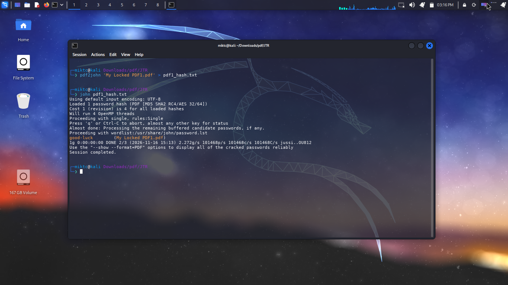
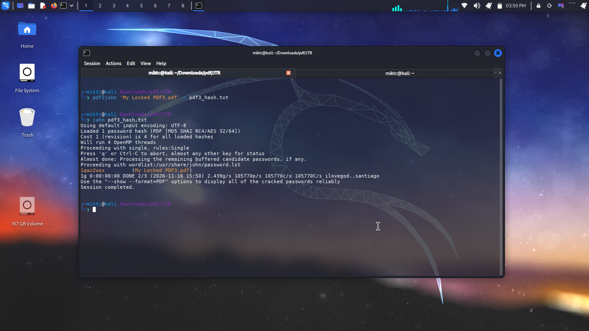
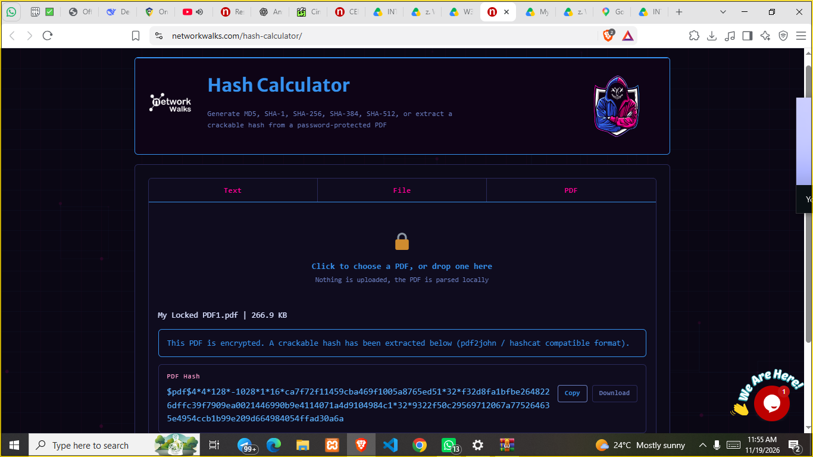
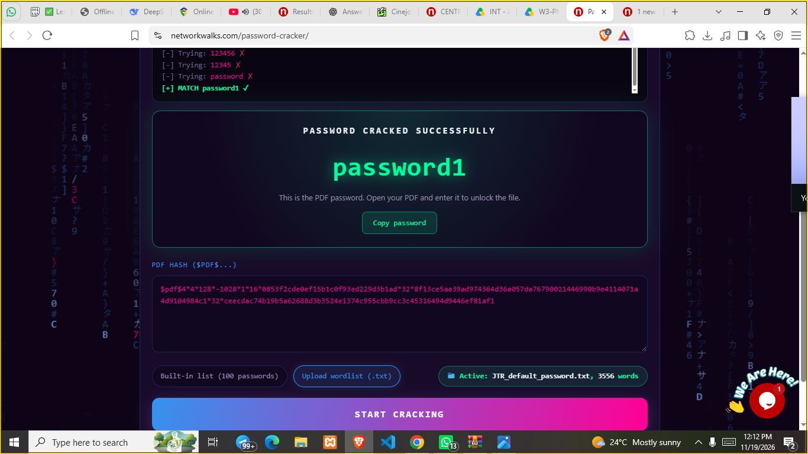
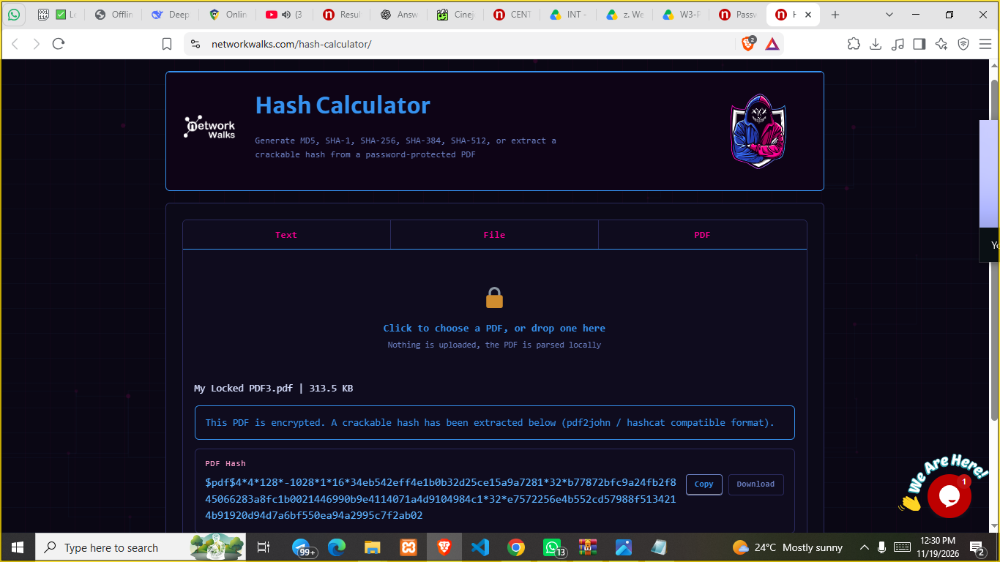
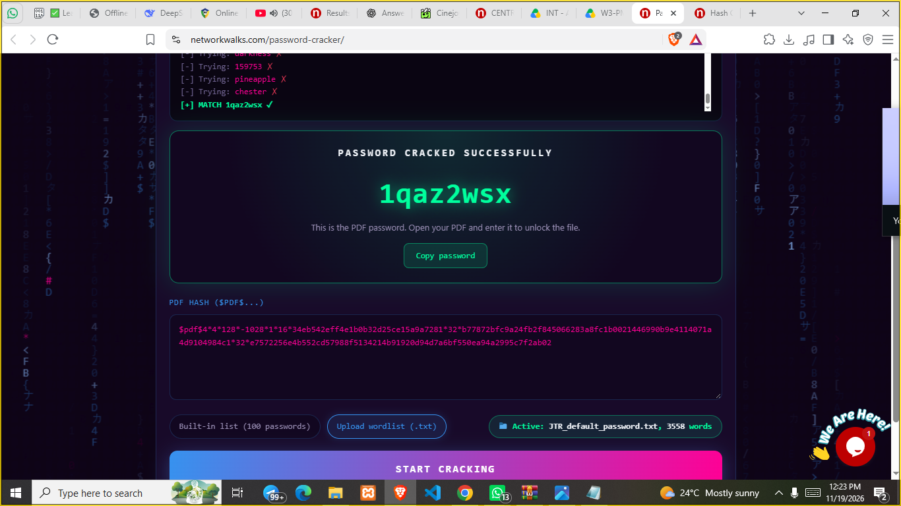

# Week 3 Project: Password Cracking

## Project Information

| Detail | Description |
|---|---|
| **Program** | Networkwalks Cybersecurity Training |
| **Batch** | B084 |
| **Project** | Week 3 – Password Cracking |
| **Operating System** | Kali Linux |
| **Tools Used** | John the Ripper and Networkwalks Password Cracking Tools |
| **Author** | John Muturi |

---

## Disclaimer

This project was conducted for educational purposes as part of the Networkwalks Cybersecurity Training Program. All password-cracking activities were performed on test PDF files in an authorized learning environment.

The techniques demonstrated in this project should only be used on files and systems that you own or have explicit permission to test.

## 1. Introduction

Password cracking is a cybersecurity technique used to recover or identify passwords from stored password hashes or protected files.

In this project, I explored two approaches to password cracking:

1. **John the Ripper (JTR):** A password-cracking tool used to test password hashes and recover passwords.
2. **Networkwalks Password Cracking Tools:** Online tools used to calculate file hashes and attempt to crack the generated hashes.

The practical exercises involved three PDF test files. Each file was tested using both approaches to understand how password hashes are generated, processed, and cracked.

## 2. Project Objectives

The main objectives were to:

- Understand the concept of password hashing and password cracking.
- Gain practical experience using John the Ripper in Kali Linux.
- Generate hashes from PDF files.
- Use password-cracking tools to test the generated hashes.
- Compare the workflows of a local password-cracking tool and Networkwalks online tools.
- Understand the importance of strong passwords and secure file protection.

## 3. Tools and Technologies Used

| Tool | Purpose |
|---|---|
| Kali Linux | Operating system used for the practical exercises. |
| John the Ripper | Used to perform password-cracking exercises locally. |
| Networkwalks Hash Calculator | Used to generate hashes from the PDF test files. |
| Networkwalks Password Cracking Tool | Used to attempt to crack the generated hashes. |
| PDF Test Files | Files used for the password-cracking exercises. |

## 4. Practical Activities

### Module 1: Password Cracking with John the Ripper

In this module, I used John the Ripper on Kali Linux to perform password-cracking exercises on three PDF test files.

The process involved working with the PDF files, their corresponding hash files, and John the Ripper commands to attempt password recovery.

**Files used:**

- `pdf1`
- `pdf2`
- `pdf3`

Each PDF had a corresponding hash text file containing the extracted hash information.

#### Exercise 1: PDF 1

The first exercise involved using John the Ripper to process the hash associated with the first PDF test file.

**Screenshot:**

#### Exercise 2: PDF 2

The second exercise involved repeating the password-cracking process using the second PDF test file and its corresponding hash.

**Screenshot:**

#### Exercise 3: PDF 3

The third exercise involved performing the same process on the third PDF test file.

**Screenshot:**

### Module 2: Password Cracking with Networkwalks Tools

In this module, I used the Networkwalks online tools to calculate hashes and attempt to crack the hashes generated from the three PDF test files.

The process involved two main steps for each PDF:

1. Uploading or submitting the PDF file to the Networkwalks Hash Calculator to generate its hash.
2. Submitting the generated hash to the Networkwalks Password Cracking Tool to attempt password recovery.

#### Exercise 1: PDF 1

**Step 1: Hash Calculation**

The first PDF was submitted to the Networkwalks Hash Calculator to generate its hash.

**Step 2: Password Cracking**

The generated hash was submitted to the Networkwalks Password Cracking Tool.

#### Exercise 2: PDF 2

**Step 1: Hash Calculation**

The second PDF was submitted to the Networkwalks Hash Calculator to generate its hash.

**Step 2: Password Cracking**

The generated hash was submitted to the Networkwalks Password Cracking Tool.

#### Exercise 3: PDF 3

**Step 1: Hash Calculation**

The third PDF was submitted to the Networkwalks Hash Calculator to generate its hash.

**Step 2: Password Cracking**

The generated hash was submitted to the Networkwalks Password Cracking Tool.

## 5. Challenges and Lessons Learned

The practical exercises provided an opportunity to understand the different stages involved in password cracking.

Key lessons included:

- Understanding how password-protected PDF files can be processed for password-cracking exercises.
- Learning how password hashes are generated and used during password-cracking attempts.
- Gaining experience using command-line tools in Kali Linux.
- Understanding the workflow of online hash-calculation and password-cracking tools.
- Recognizing that password recovery depends on factors such as password complexity and the capabilities of the cracking tool.

## 6. Security Considerations

This project demonstrates why strong password practices are important.

Some security recommendations include:

- Use long and complex passwords.
- Avoid common words and predictable password patterns.
- Do not reuse passwords across different accounts or files.
- Use secure password-storage methods when developing applications.
- Protect sensitive files with strong passwords and appropriate encryption.
- Only perform password-cracking activities with proper authorization.

## 7. Conclusion

The Week 3 project provided practical experience with password-cracking techniques using John the Ripper and Networkwalks Password Cracking Tools.

Through the two modules, I worked with three PDF test files, explored hash generation, and attempted password recovery using different tools.

The exercises improved my understanding of password hashes, password-cracking workflows, and the importance of strong password security.

## 8. Evidence Collected

The project contains nine screenshots documenting the practical activities:

- **Module 1:** Three screenshots showing the John the Ripper exercises.
- **Module 2:** Six screenshots showing hash calculation and password-cracking attempts for the three PDF files.

The corresponding `.txt` files in Module 1 contain the hash information used during the exercises.

---
Author: John Muturi

**Networkwalks Cybersecurity Training – Week 3 Project**  
*Password Cracking with John the Ripper and Networkwalks Tools*
